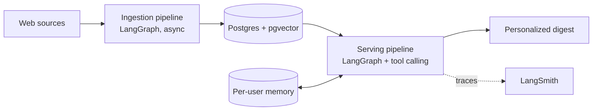

  

  
  
  
  

---

## 👨‍💻 About Me

I build **agentic AI and Retrieval-Augmented Generation (RAG) systems** that are measured, observable and hardened against attacks, not just demos.

| | |
|---|---|
| 🔭 **Focus** | Agentic AI, RAG, LLM evaluation, tool calling |
| 🏢 **Now** | Automation Engineer at BAAR Technologies, delivering products with end-to-end ownership across 4+ client environments (ServiceNow, Active Directory) |
| 📊 **How I work** | RAGAS and LangSmith evaluation, tracing, cost and latency tracking |
| 🛡️ **Security** | Prompt-injection testing and guardrails on every agent |
| 🎓 **Education** | B.Tech CSE, VIT Vellore (CGPA 8.67) |
| 📍 **Location** | Hyderabad, India |

---

## ⭐ Featured Projects

### 🚀 [StackPulse](add-repo-link): Developer Intelligence Digest
> Production-grade, multi-source agentic AI pipeline that delivers a personalized developer digest.

| 💸 Cost | ⚡ Retrieval | 🎯 Accuracy | 🛡️ Security |
|:---:|:---:|:---:|:---:|
| **74%** lower LLM inference cost | **<15 ms** pgvector semantic search | **94.2%** tool-selection accuracy | **20/20** prompt injections blocked |

* **0.91** faithfulness and **4.2s** P95 latency on a 60-task benchmark (LangSmith + RAGAS)
* **50–80 token** tool payloads per user instead of stuffing whole articles into context
* Persistent per-user memory that removes duplicate recommendations

[🔗 Live](add-live-link) • [💻 Code](add-repo-link)

### 🔍 [CertRAG](add-repo-link): Hybrid RAG System
> Hybrid retrieval with hand-implemented BM25, dense embeddings, Reciprocal Rank Fusion and cross-encoder re-ranking.

| 📈 MRR | 📈 Recall@5 | ✅ Hallucination judge |
|:---:|:---:|:---:|
| **0.58 → 0.75** | **0.63 → 0.75** | **92%** agreement with human judgment |

[💻 Code](add-repo-link)

---

## 🛠️ Tech Stack

**GenAI & Agents**

**Languages, Backend & DevOps**

  

**Data & ML**

  

## 📫 Let's Connect

I'm open to **AI Engineer / GenAI Engineer** roles. If you're building agentic or RAG systems and care about evaluation and security, reach out by [email](mailto:nknomankhan598@gmail.com) or on [LinkedIn]([your-linkedin-url]).

